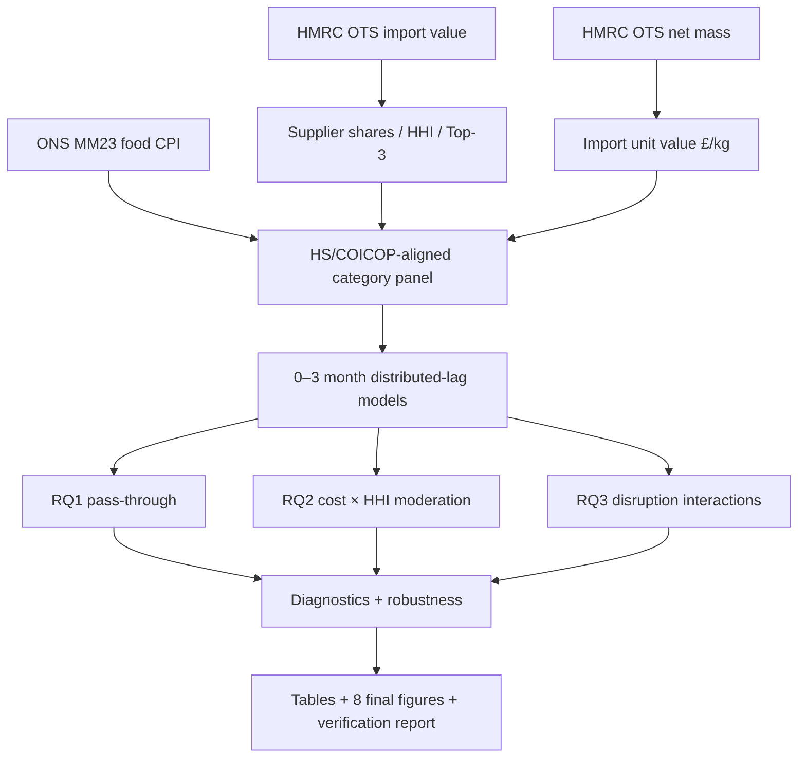
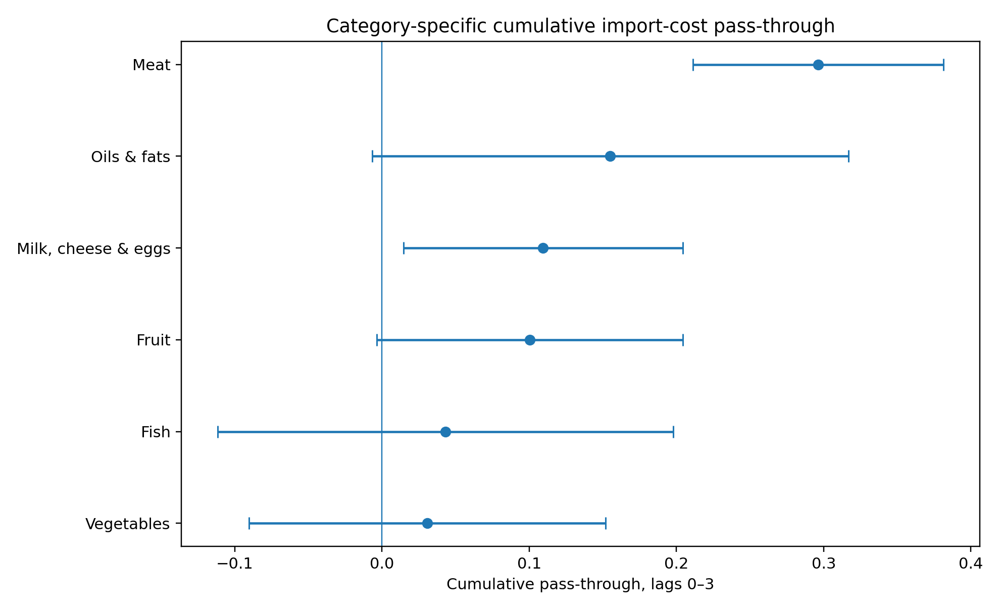
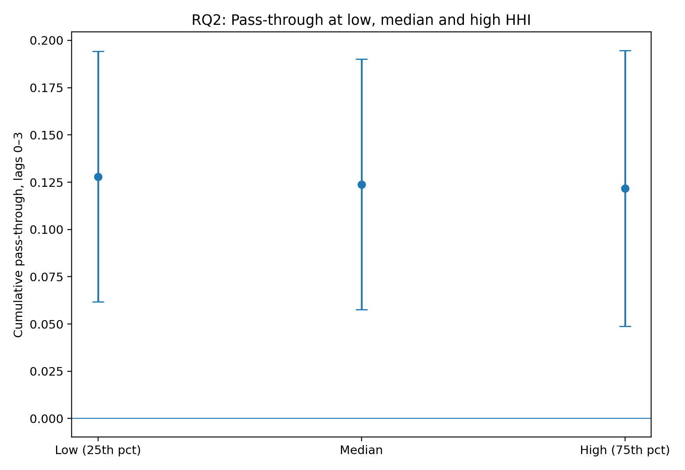
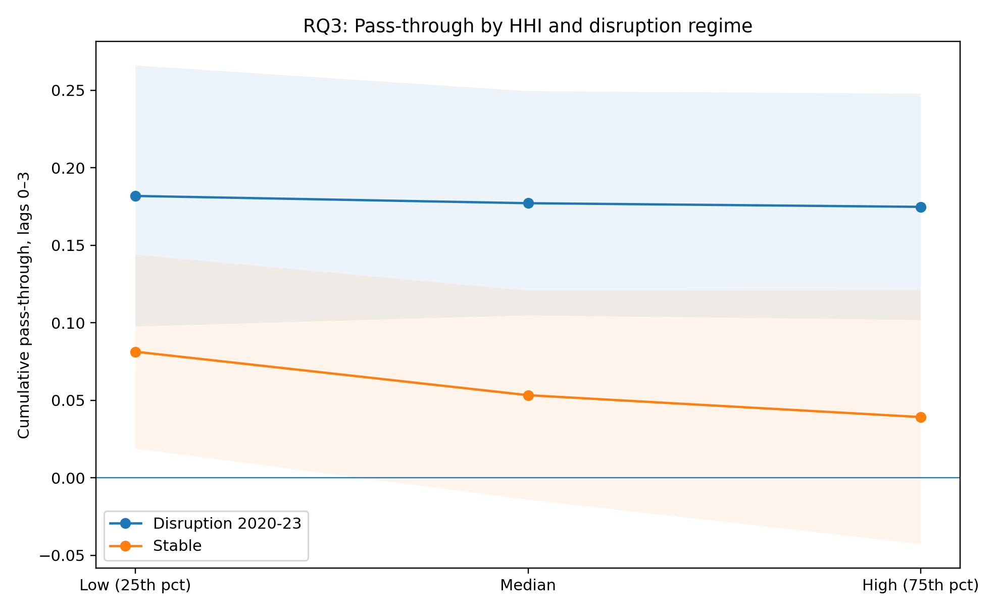
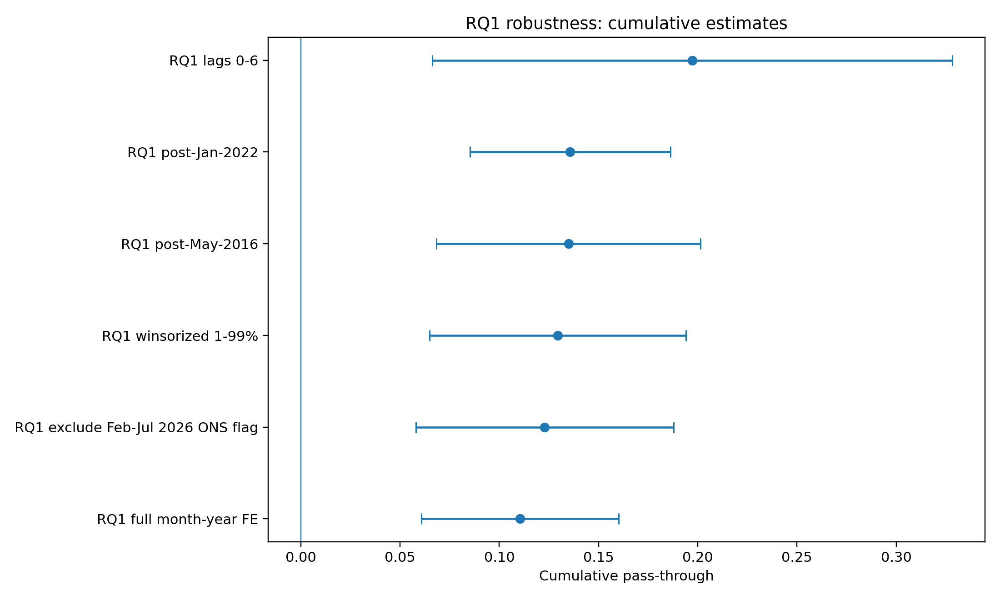

# UK Food Price Pass-Through

[](https://github.com/jeevanchowdary04/UK-Food-Price-Pass-Through/actions/workflows/ci.yml)

**Research title:** *The Role of Import-Supplier Concentration in UK Food Price Pass-Through: A Category-Level Analysis, 2014–2026*

This repository contains the Python implementation for a UK food-price pass-through study using official **HMRC UK Trade Info** import data and **ONS MM23** food CPI data. It includes the data preparation, model code, diagnostics, robustness checks and figures used in the dissertation.

## Research questions

1. **RQ1 — Pass-through:** What are the magnitude and lag structure of category-level import-cost pass-through to UK consumer food prices?
2. **RQ2 — Concentration:** To what extent does import-supplier concentration influence the magnitude and timing of pass-through?
3. **RQ3 — Disruption:** Does the concentration/pass-through relationship differ between the 2020–2023 disruption period and more stable periods?

## Analytical snapshot

| Item | Final design |
|---|---|
| Period | January 2014 – July 2026 |
| Frequency | Monthly |
| Categories | Meat; Fish; Milk, cheese & eggs; Oils & fats; Fruit; Vegetables |
| Master panel | 906 category-month observations |
| Primary estimation sample | 882 observations |
| Import-cost proxy | Monthly log change in import unit value (£/kg) |
| Concentration | HHI; Top-3 supplier share as robustness |
| Primary lag window | 0–3 months |
| Inference | HAC-groupsum / Driscoll–Kraay-type covariance |

## Headline empirical results

| Research test | Estimate / evidence | Conclusion |
|---|---:|---|
| RQ1 cumulative pass-through, lags 0–3 | **0.1253**; 95% CI [0.0620, 0.1887]; p < 0.001 | Positive short-run pass-through supported |
| RQ2 cumulative HHI moderation | **−0.1027**; p = 0.819 | No statistically reliable HHI moderation |
| RQ3 disruption minus stable at median HHI | **0.1238**; p = 0.007 | Pass-through stronger in 2020–2023 |
| RQ3 concentration-specific disruption interaction | **0.5809**; p = 0.440 | Concentration-specific amplification not supported |

The estimates are **associations, not causal effects**. Country-level HHI is a structural sourcing-concentration measure and does not directly observe contracts, inventories, bargaining power, retailer margins or domestic substitution.

## Analytical workflow



## Core formulas

Supplier-country share:

\[
s_{jct}=\frac{V_{jct}}{\sum_j V_{jct}}
\]

Herfindahl-Hirschman Index:

\[
HHI_{ct}=\sum_j s_{jct}^2
\]

Import unit value:

\[
UV_{ct}=\frac{ImportValue_{ct}}{NetMass_{ct}}
\]

Monthly log changes:

\[
\Delta Cost_{ct}=100\Delta\ln(UV_{ct}),\qquad
\Delta CPI_{ct}=100\Delta\ln(CPI_{ct})
\]

The full RQ1–RQ3 model equations and formula-to-code mapping are in [`docs/03_FORMULAS_AND_MODELS.md`](docs/03_FORMULAS_AND_MODELS.md).

## Reproduce the analysis

```bash
python -m venv .venv
# Windows: .venv\Scripts\activate
# macOS/Linux: source .venv/bin/activate
python -m pip install --upgrade pip
pip install -r requirements-lock.txt

python scripts/00_validate_environment.py
python scripts/03_reproduce_final_analysis.py
python scripts/04_make_figures.py
python scripts/05_verify_reported_results.py
pytest -q
```

The analysis and figure scripts run from the bundled, verified monthly analytical extracts and therefore do **not** require a live API connection. To refresh HMRC source data, run `scripts/01_acquire_hmrc.py` on an internet-enabled machine, then rebuild the panel.

## Repository map

```text
config/              Frozen project and HS/COICOP concordance
 data/                Source notes, ONS data, verified HMRC monthly extracts
 src/                 Reusable research functions
 scripts/             Acquisition, panel, analysis, figures, verification
 tests/               Research-integrity and numerical-regression tests
 results/tables/      Final statistical outputs
 results/figures/     Eight numbered dissertation figures
 results/reports/     Technical and reproducibility reports
 docs/                Research design, formulas, implementation, diagnostics
 technical_evidence/  Formula, code and result traceability notes
 provenance/          Source, query and live-extraction manifests
```

## Figures

### Category-specific cumulative pass-through


### RQ2: marginal pass-through by HHI


### RQ3: pass-through by disruption regime


### RQ1 robustness


## Reproducibility and research integrity

- The HS-to-CPI concordance is frozen and version controlled.
- Data-source and HMRC query provenance are retained under `provenance/`.
- **35 automated tests** check panel balance, category coverage, formula behaviour, HHI bounds, lag completeness, headline numerical results and robustness-sign stability.
- `scripts/05_verify_reported_results.py` checks the headline numerical results against the generated result tables and writes a verification report.
- The 2020–2023 regime is treated as a broad disruption period, not a single causal intervention.
- HMRC unit values are treated as **cost proxies**, not pure transaction-price indices.

See [`docs/06_LIMITATIONS_AND_ETHICS.md`](docs/06_LIMITATIONS_AND_ETHICS.md) before interpreting the estimates.

## Data provenance

The audited HMRC extraction covered **58,196 supplier-country-month records** across the six categories. The full supplier-country table is not committed; the exact query manifest, extraction audit and six 151-month category-level analytical extracts are retained, and the acquisition script can reproduce the source extraction. See [`data/raw/hmrc/HMRC_RAW_DATA_NOTE.md`](data/raw/hmrc/HMRC_RAW_DATA_NOTE.md).

## Author and citation

Research implementation by **Jeevan Chowdary Guntipalli**. Citation metadata are provided in [`CITATION.cff`](CITATION.cff). Code is released under the MIT License; official source data remain subject to their respective publisher terms.
